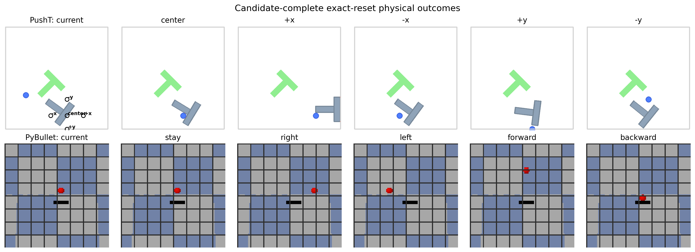
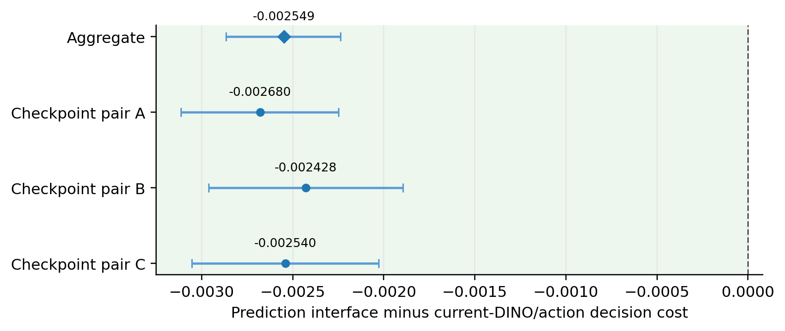

# Routing World-Model Compute from Predicted Consequences

[](https://github.com/malodept/wmroute/actions/workflows/verification.yml)

**Paper status:** preprint; arXiv submission pending.

World-model systems can spend more compute by invoking a larger predictor, but a larger predictor is not necessarily the better decision-maker for every state and task. This repository studies a simple question:

> After running a Medium world model, can its predicted consequences tell us when paying for a separately trained Full model will improve the physical decision enough to justify the extra latency?

The main contribution is a **candidate-complete paired exact-reset evaluation protocol**. Every candidate action is executed from the same simulator state, so Medium and Full are compared on identical physical outcomes rather than different samples.

<p align="center">
  
</p>

## Main result

On a prospectively sealed second PushT bank of 1,600 fresh states, the prediction-interface router beats a deliberately favoured control that receives the task, current DINO features, and all five candidate actions at matched input dimension.

| Comparison | Difference in priced decision cost | 95% state-clustered interval |
|---|---:|---:|
| Prediction interface − current-DINO + actions | **−0.002549** | **[−0.002867, −0.002238]** |

Negative values favour the prediction interface. All three fixed checkpoint-pair effects are negative. The control is slightly faster, but the prediction interface reduces physical regret enough to lower the priced objective by 7.9%.

<p align="center">
  
</p>

## What this repository contains

- `paper/`: the current preprint PDF and LaTeX source;
- `src/wmroute/`: reusable implementations of routing costs, information-interface value, and clustered inference utilities;
- `scripts/`: paper-facing table, figure, replay, and confirmation checks;
- `artifacts/`: compact released arrays, per-state tables, seals, manifests, and paper-facing statistics;
- `tests/`: mathematical identities, bootstrap semantics, frozen-source checks, and paper-value regression tests;
- `docs/`: scientific scope, reproducibility notes, limitations, and a static project page.

The repository supports paper-facing recomputation without a GPU or simulator. Full physical outcome regeneration still requires external simulators, encoders, checkpoints, and the original environment-specific assets.

## Quick verification

```bash
python -m venv .venv
source .venv/bin/activate              # Windows: .venv\Scripts\activate
python -m pip install --upgrade pip
python -m pip install -r requirements/verification.txt
python -m pip install -e .
bash scripts/run_all_checks.sh
```

Expected terminal markers include:

```text
WMROUTE_PUBLIC_RELEASE_VERIFY_PASS
PROSPECTIVE_CONFIRMATION_VERIFICATION_PASS
WMROUTE_ALL_CHECKS_PASS
```

## Rebuild paper-facing tables and figures

```bash
python scripts/build_main_tables.py
python scripts/build_main_figures.py
```

Outputs are written under `generated/`.

## Scientific scope

Supported by the released evidence:

- Medium and Full are not decision-ordered state by state;
- a Medium-derived prediction interface supports useful post-hoc routing;
- the sealed prediction interface beats one strong current-DINO/action alternative;
- the paired exact-reset physical estimand and paper-facing statistics are reproducible from the released records.

Not established:

- raw latency, energy, or compute saving;
- closed-loop control value;
- universal superiority of predicted futures over current-state representations;
- generality across genuinely different world-model families;
- a new generic adaptive-routing theory.

See [`docs/claims_and_limitations.md`](docs/claims_and_limitations.md) and the paper for the precise claim boundary.

## Project page

The static page is under [`docs/index.html`](docs/index.html). After enabling GitHub Pages from the `docs/` directory, it will be available at:

`https://malodept.github.io/wmroute/`

## Citation

Citation metadata is provided in [`CITATION.cff`](CITATION.cff). The arXiv identifier will be added after submission.

## Licensing status

This release is public for inspection and reproducibility review, but no open-source licence is granted yet. See [`LICENSE.md`](LICENSE.md) and [`THIRD_PARTY_NOTICES.md`](THIRD_PARTY_NOTICES.md). A standard software licence can be added after the rights review is complete.
